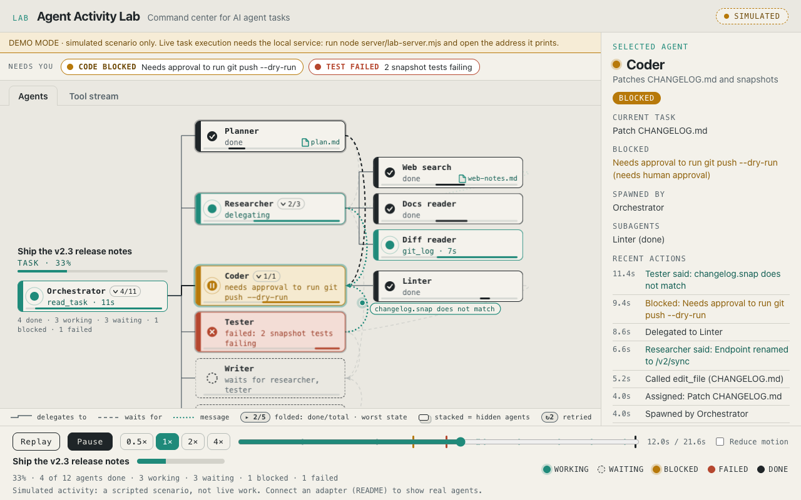

# Agent Activity Lab

**A local command center for AI agents.** Type a task, press Run, and a real Claude Code session executes it while you watch what each agent is doing: tool calls, subagents, handoffs, blockers, failures, and the files it produces.



> **Two modes, never mixed up.** The public demo and the screenshots above are a **simulated** scripted run (every page carries a SIMULATED badge). **Live execution is local only**: it runs on your computer with your own Claude Code login. The badge always says which one you are looking at (SIMULATED, LIVE · Claude Code session, SAVED, REPLAY, or TEST STUB).

## Try it

- **Demo (simulated):** open `app/index.html` (or the GitHub Pages site). It replays a scripted task through the Agents view so you can click around.
- **Run real tasks (local):**
  ```bash
  git clone https://github.com/pomegranate692-creator/agent-activity-lab && cd agent-activity-lab
  claude auth login                 # Claude Code must be signed in
  node server/lab-server.mjs        # then open the address it prints
  ```
  Press **New task**, choose a policy, read the summary, **Run**. Needs Node 18+ and the Claude Code CLI. Nothing else to install.

## What it does

- **Agents (primary view):** a card tree of the main agent and its real subagents. Each card shows state, current tool and elapsed time, outputs, retries and an activity lane. **Needs You** lists blocked and failed agents with their reasons.
- **Tool stream:** every tool call in time order, with filters and grouping. **Output:** the final answer, generated files, denied actions (approve and re-run), cost. **History:** every run is saved locally; reopen, retry or stop.
- Nothing is invented: subagents come from real Agent tool calls, messages only when a subagent returns its report, outputs from real files.

## Status (honest)

| Claim | Evidence |
|---|---|
| Service plumbing, security rules, dashboard flow | 57 server checks and 27 app checks pass, using a **test stub** that speaks Claude Code's stream format (labelled TEST STUB; it is not Claude) |
| Message mapping on real Claude Code message shapes | tested on 1,552 real transcript lines |
| **A real Claude Code run end to end** | **not yet verified** (the author's CLI was signed out). `node tools/milestone-check.mjs` runs the first-milestone workflow for real and checks every step |
| Real subagent delegation, real permission-denial wording | mapped from the documented format, unverified until a real run |
| Pause a running task; approve during a run | not supported (headless Claude Code); approve and re-run is supported |

Security model, controls and limits: [server/README.md](server/README.md). It is a code-execution surface: localhost only, token-protected, tool allowlist, workspace folder per task, budget cap. The Workspace policy lets Python run with your user permissions, so only run tasks you trust.

## Design

The primary view is the **Card tree**, chosen from ten designs scored on clarity, usability, real-time monitoring, scale and aesthetics ([docs/DESIGN-REVIEW.md](docs/DESIGN-REVIEW.md)). All ten, plus two experiments that merged them, are kept in the [archive](archive/index.html). Research on 40+ similar GitHub projects: [research/RESEARCH.md](research/RESEARCH.md) (links only, no code copied; check each project's license).

## Real activity from other sources

`tools/hooks-install.mjs` previews (dry run) and, only with `--apply`, installs Claude Code hooks that feed the viewer; `tools/hook-coverage.mjs` reports which hook events a real log has proven (3 of 11 so far). `tools/transcript-to-events.mjs` replays a recorded session. See [shared/README.md](shared/README.md).

## Start your own from one of the designs

```bash
node tools/pick.mjs --list
node tools/pick.mjs 09-card-tree ../my-agent-view && cd ../my-agent-view && npm start
```

## Tools and tests

`node tools/app-test.mjs` (app), `node server/test-e2e.mjs` (service), `node tools/qa.mjs` (archived designs; `cd tools && npm install` first for puppeteer-based tools).

## License

MIT, see [LICENSE](LICENSE).
