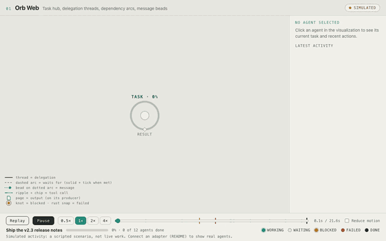
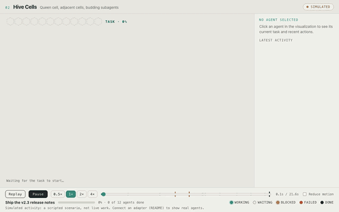
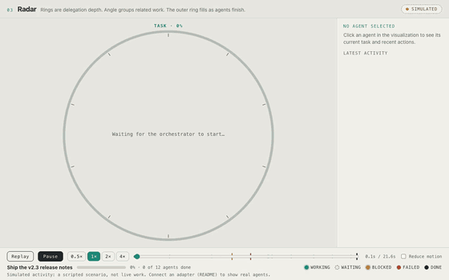
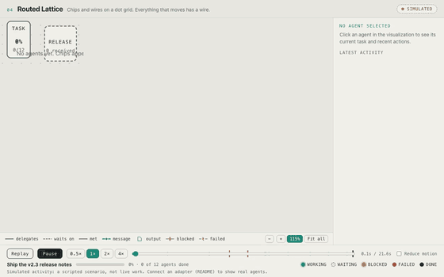
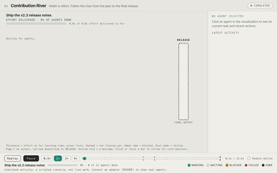
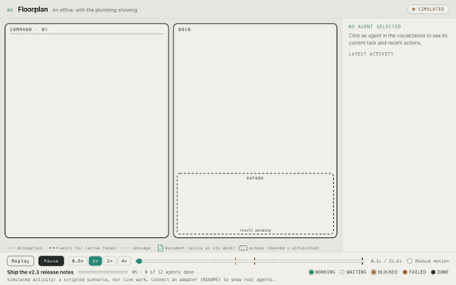
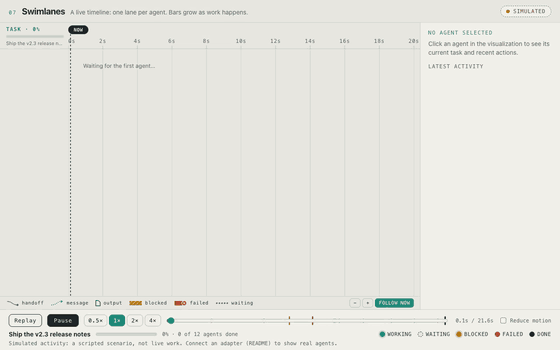
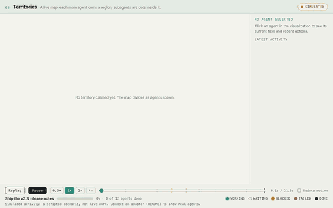
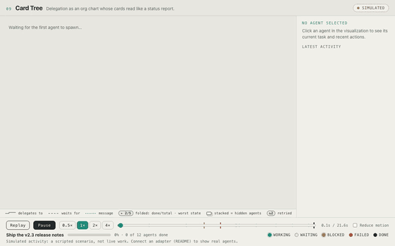
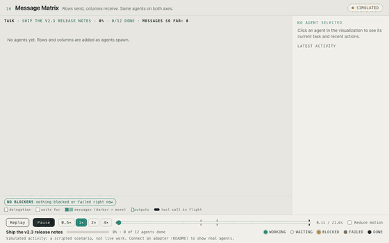

# Agent Activity Lab

**Ten runnable designs for watching AI agents work.** Who is doing what, who handed work to whom, what is waiting or blocked (and why), what failed and recovered, and what came out at the end.

> Everything in the demos is **simulated**: one scripted task replayed in ten visual styles so you can compare them fairly. Every design shows a SIMULATED / LIVE / REPLAY / SELF-REPORTED badge that it cannot remove. Nothing here is a real agent run unless you connect real events.

<table>
<tr><td width="50%"><a href="prototypes/01-orb-web/index.html"></a><br><b>01 Orb web</b><br>Hub, threads and arcs. The literal spiderweb.</td><td width="50%"><a href="prototypes/02-hive-cells/index.html"></a><br><b>02 Hive cells</b><br>Honeycomb; subagents bud off their parent.</td></tr>
<tr><td width="50%"><a href="prototypes/03-radar/index.html"></a><br><b>03 Radar</b><br>Rings are delegation depth.</td><td width="50%"><a href="prototypes/04-routed-lattice/index.html"></a><br><b>04 Routed lattice</b><br>Chips and wires, like a circuit board.</td></tr>
<tr><td width="50%"><a href="prototypes/05-contribution-river/index.html"></a><br><b>05 Contribution river</b><br>Width is effort, flowing to the result.</td><td width="50%"><a href="prototypes/06-floorplan/index.html"></a><br><b>06 Floorplan</b><br>An office with the plumbing showing.</td></tr>
<tr><td width="50%"><a href="prototypes/07-swimlanes/index.html"></a><br><b>07 Swimlanes</b><br>One lane per agent over time.</td><td width="50%"><a href="prototypes/08-territories/index.html"></a><br><b>08 Territories</b><br>Each agent owns a region of a map.</td></tr>
<tr><td width="50%"><a href="prototypes/09-card-tree/index.html"></a><br><b>09 Card tree</b><br>An org chart of status cards.</td><td width="50%"><a href="prototypes/10-message-matrix/index.html"></a><br><b>10 Message matrix</b><br>Rows send, columns receive.</td></tr>
</table>

Each design is plain HTML, CSS and JS (no build step, no dependencies). Pause, replay, change speed, scrub the timeline, and click any agent to see its current task and recent actions. Keyboard works; reduced motion is respected.

## Pick one and start your own

```bash
git clone https://github.com/OWNER/agent-activity-lab && cd agent-activity-lab
node tools/pick.mjs --list                       # see the designs
node tools/pick.mjs 09-card-tree ../my-agent-view
cd ../my-agent-view && npm start                 # http://127.0.0.1:7777
```

You get a standalone folder: the design (`proto.js`, `proto.css`), the shared event model and UI shell (`shared/`), a tiny local server, and `DESIGN-NOTES.md` explaining how that design encodes states, delegation, messages and outputs, and where it breaks.

Or just open `prototypes/<name>/index.html` in a browser, or run `node shared/adapter-server.mjs` and visit `http://127.0.0.1:7777/prototypes/<name>/index.html`. `?scenario=stress` loads a 30-agent run.

## The combined viewer

`app/` puts Card tree, Swimlanes and Contribution river in one shell with a Tool stream view for single-agent runs and a "Needs you" strip for blocked or failed agents. See [app/README.md](app/README.md).

## Which one?

[COMPARISON.md](COMPARISON.md) scores all ten (clarity, appeal, usefulness in real tasks, scale, effort). Short version:

- **Card tree (09)**: everyday status; folds finished work so 30 agents stay readable.
- **Swimlanes (07)**: the only one that shows *when* things happened and who waited on whom.
- **Contribution river (05)**: how every agent's effort fed the final result.

Scores are one author's judgment from screenshots, stress frames and code, not user testing.

## Feed it real events

All designs consume one event model (`task_started`, `agent_spawned`, `work_delegated`, `tool_called`, `message_sent`, `agent_blocked`, `agent_completed`, `task_finished`, plus unblock, fail, retry and output events). See [shared/README.md](shared/README.md).

| Path | What it does | Status |
|---|---|---|
| `POST /event` | Your script or agent reports events | works; badge says SELF-REPORTED |
| `POST /claude-hook` | Claude Code hook payloads | session start, prompt and end fields checked against real payloads; **tool-level hook events are not verified against a real session** |
| `node tools/transcript-to-events.mjs <transcript.jsonl>` + `POST /replay` | Replays a recorded Claude Code session | works on real transcripts; transcripts do not record permission waits, messages or outputs |

## Known limits

- Tested in headless Chrome at 1280x800 only. Not tested in other browsers, with screen readers, or on touch.
- A real Claude Code session is mostly one agent making sequential tool calls, which the many-agent designs show poorly. A single-agent tool-stream view is the next design step.
- `research/RESEARCH.md` summarises 40+ similar GitHub projects (links and verified stats, no code copied). Check each project's license before reusing its ideas or assets.
- `paper/boards/` holds the original SVG concept boards.

## Tools

`tools/capture.mjs` records a running design to mp4/gif/png (needs Chrome and ffmpeg), `tools/qa.mjs` smoke-tests every design, `tools/pick.mjs` starts your own project. `cd tools && npm install` first for the two that use puppeteer-core.

## License

MIT, see [LICENSE](LICENSE).
